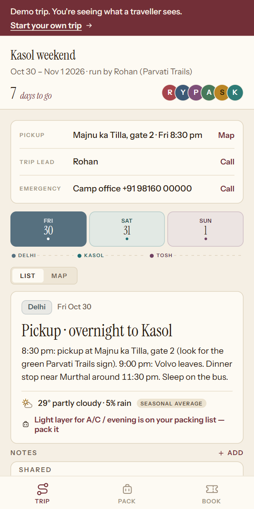

# Roundtrip

A trip planner for groups. One person creates a trip and shares a link, and
everyone on it sees the same itinerary, packing list, bookings and documents,
synced in near real-time. Installs to the home screen and works offline.

Right now it's being tested with small trip operators who run weekend group
trips: the organiser sets up the plan, drops one link in the WhatsApp group,
and travellers tap it, type their name and they're in.

Live at [roundtrip.one](https://roundtrip.one) (landing) and
[app.roundtrip.one](https://app.roundtrip.one) (the app). See a read-only
sample trip at [app.roundtrip.one/demo](https://app.roundtrip.one/demo). No
account needed to start.



## Why I built it

I was planning a 24-day trip with a group and we were running it across a
spreadsheet, three chat threads and a folder of screenshots. Nobody knew
which version of the plan was current. So I built this, and then used it
every day of that trip. Most of the design decisions came from things that
annoyed us while we were actually travelling: the packing list needed to be
per person but the budget needed to be shared, notes needed to work with no
signal, and nobody wanted to make an account before they could see anything.

## What's in it

Itinerary with per-day weather and a trip map, packing lists (the organiser
sets the list, each person ticks their own), a booking checklist, a documents
wallet for tickets and PDFs, and a shared budget with settle-up. Light and
dark themes. Backup and restore of a whole trip as JSON.

**Join links.** `app.roundtrip.one/j/CODE` opens a trip directly: no intro
screens, just a name and you're in. The six-letter code still works as a
fallback.

**Organisers and members.** Whoever creates the trip is its organiser.
Members see the shared plan; the organiser decides whether they can edit it.
Everyone keeps their own packing list and personal notes.

**Demo.** `/demo` renders a bundled three-day Kasol weekend read-only, with
no sign-in and no backend calls.

### The AI parts

**Itinerary planner.** In the trip wizard, generates a starting plan for the
destinations and dates you picked.

**Paste your itinerary.** Paste the plan you already send on WhatsApp and it
gets sorted into the trip's days.

Both run on Gemini, server-side in `api/` (Vercel functions, also mounted on
the dev server), behind a Supabase sign-in check and a daily cap, so the key
never reaches the browser.

## Stack

Vite and React (CSS Modules with design tokens) on Supabase. Anonymous-first
auth: everything works as a guest in one browser, and linking an email or
Google account carries the same identity onto other devices.

ESLint and Vitest, Sentry for errors, GitHub Actions for CI and for versioned
`pg_dump` backups.

## Develop

```bash
npm install
npm run dev
```

## Backend setup (one-time)

The app uses a free Supabase project for sync and auth. Follow
`supabase/SETUP.md`: create the project, run `supabase/schema.sql` once and
never again because it drops the tables, then run each file in
`supabase/migrations/` in number order. They are additive and live-safe. Enable the auth
providers, and put your project URL and anon key in `.env.local`.

### Optional keys, all with free tiers

| Variable | What it turns on |
|---|---|
| `VITE_UNSPLASH_ACCESS_KEY` | Real destination photos on trip cards instead of gradients |
| `GEMINI_API_KEY` | The itinerary planner and paste-your-itinerary (server-side only) |

## Deploy

Two Vercel projects off this one repo, the app at the root and the landing
site rooted at `landing/`, both auto-deployed from `main`. The full go-live
checklist, DNS through to backups, is in `docs/LAUNCH.md`.

## How trips work

Create a trip: name, dates, currency, then search and add destinations (or
paste an itinerary). Each day is assigned to a destination automatically and
can be edited after. Share the join link; anyone who opens it joins as a
member. Each person's additions are labelled. A finished trip can be run
again on new dates.

## Where the data lives

Everything is stored in Supabase and mirrored to IndexedDB on each device as
an offline cache with a write outbox.

- **Shared by all members:** the trip definition (days, destinations, money
  settings, cover photo, packing template), shared day notes, expenses with who-paid and
  settle-up, bookings, and the document list. The files themselves live in a
  private, member-only Supabase Storage bucket.
- **Personal per member:** packing list, own per-day notes.
- **Members** carry a role (organiser or member), and each trip has a
  "members can edit" setting enforced by row-level security.
- **Profile** (display name and colour) lives in auth user metadata and
  follows your account across trips and devices.

## Structure

```
src/
  main.jsx            entry: Sentry, theme, /demo branch, install hint
  App.jsx             routing (join link -> gate -> trips home -> trip), header, tabs
  demo/               the read-only /demo trip (data in data/demo/)
  lib/joinLink.js     /j/CODE parsing and share URLs
  lib/tripConfig.js   per-trip config context + date/money helpers
  lib/session.js      trip create/join/enter, members, trips list
  lib/auth.js         account linking + sign-in (email OTP, Google)
  lib/storage.js      Supabase kv + IndexedDB cache + backup/restore
  lib/weather.js      Open-Meteo forecast, cached and synced
  lib/documents.js    documents wallet (Supabase Storage)
  components/         shared UI (wizard, settings, trips home)
  tabs/               one file per tab
api/                  serverless functions (AI itinerary, import, account delete)
supabase/             schema.sql (do not re-run) + additive migrations
landing/              the marketing site at roundtrip.one
```

Everything network-related lives in `src/lib/supabase.js`, `session.js`,
`auth.js` and `storage.js`, so swapping the backend touches four files.

Built and maintained by me, [Anmol Bajpai](https://github.com/anmolbajpai24).
